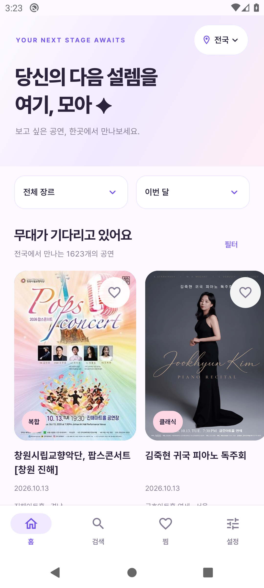
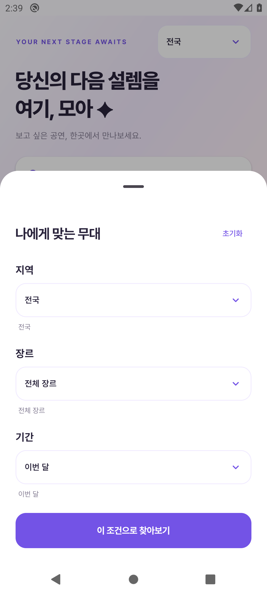
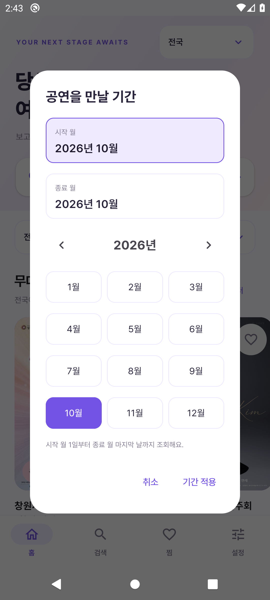
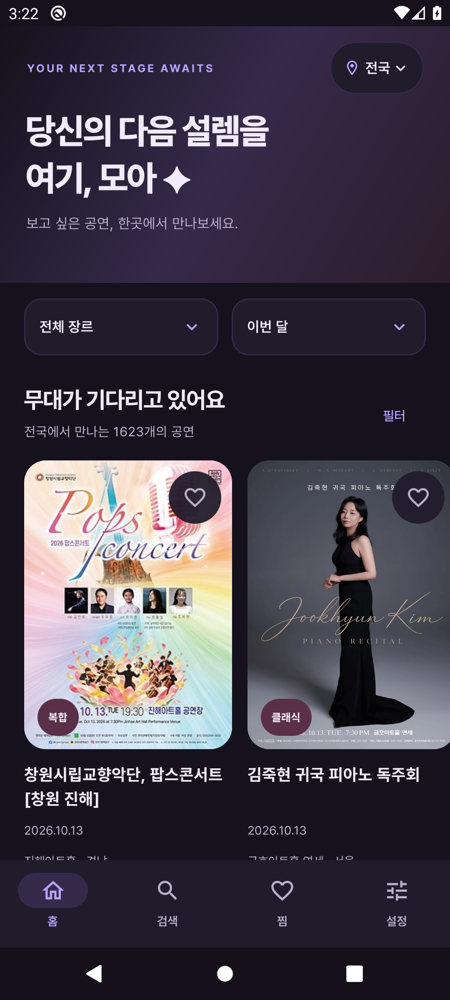
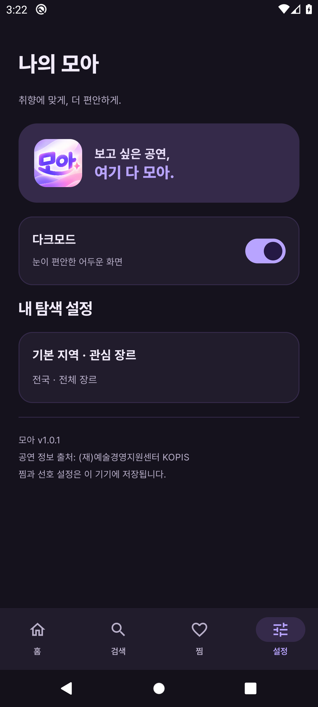
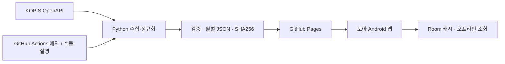

<div align="center">


# 보고 싶은 공연, 여기 다 모아 ✦

**전국의 무대를 발견하고, 다음 설렘을 모아두는 Android 앱**

콘서트부터 뮤지컬, 연극, 클래식까지.<br />
지역과 취향, 원하는 달을 골라 나에게 맞는 공연을 만나보세요.


[](https://github.com/sung-gyeonghun/MOA/actions/workflows/data.yml)

[**📥 Android APK 다운로드**](https://github.com/sung-gyeonghun/MOA/releases/download/v1.0.2-preview.1/moa-preview.apk) · [공연 데이터](https://sung-gyeonghun.github.io/MOA/) · [데이터 갱신 이력](https://github.com/sung-gyeonghun/MOA/actions/workflows/data.yml) · [요구사항](docs/performance_app_PRD_v1.0.md) · [검증 기록](docs/verification)


<sub>브랜드 콘셉트 이미지입니다. 현재 앱의 실제 화면은 아래에서 확인할 수 있습니다.</sub>

</div>

---

## ✨ 앱 둘러보기

**찾는 과정은 간결하게, 공연이 주는 설렘은 선명하게.**

라벤더와 핑크 그라데이션, 흰색 카드, Pretendard 타이포그래피로 공연 포스터가 돋보이도록 구성했습니다. 메인 배너의 작은 지역 버튼과 두 개의 드롭다운에서 탐색을 시작할 수 있습니다.

<table>
  <tr>
    <th align="center">Discover · 다음 무대 찾기</th>
    <th align="center">Filter · 취향 좁히기</th>
    <th align="center">Period · 보고 싶은 달 선택</th>
  </tr>
  <tr>
    <td width="33%" align="center"></td>
    <td width="33%" align="center"></td>
    <td width="33%" align="center"></td>
  </tr>
  <tr>
    <td align="center">지역 버튼 · 장르와 기간<br />실제 포스터와 공연 목록</td>
    <td align="center">지역·장르 복수 선택<br />메뉴 아래 선택 내용 요약</td>
    <td align="center">연·월만 선택<br />월의 첫날부터 마지막 날까지</td>
  </tr>
</table>

<details>
<summary><strong>다크모드 화면 보기 · v1.0.1</strong></summary>

<table><tr><th>다크모드 홈</th><th>설정 토글</th></tr><tr>
<td align="center"></td>
<td align="center"></td>
</tr></table>

홈 검색창은 제거했습니다. 검색은 하단 검색 탭에서 이용하며, 키보드가 열리면 하단 메뉴를 숨기고 닫히면 다시 표시합니다.

</details>

### 원하는 무대를 찾는 방법

| 기능 | 모아에서 할 수 있는 일 |
| :--- | :--- |
| 📍 지역 | 전국 또는 여러 지역을 선택합니다. **전국과 개별 지역은 함께 선택되지 않습니다.** |
| 🎭 장르 | 콘서트·뮤지컬·연극·클래식·국악·무용·서커스/마술·복합·축제를 탐색합니다. **전체 또는 여러 장르**를 선택합니다. |
| 🗓️ 기간 | **이번 달 / 3개월 / 6개월 / 직접 선택**으로 조회합니다. 직접 선택은 시작 연·월과 종료 연·월을 지정합니다. |
| 🔎 검색 | 공연명과 출연진을 검색하고, 최근 검색어를 다시 사용하거나 삭제합니다. |
| 🎟️ 상세 | 기간·공연장·가격·관람 시간·연령·출연진·안내를 확인하고 공식 예매처를 외부 브라우저로 엽니다. |
| 💜 찜 | 마음에 드는 공연을 저장합니다. 앱을 종료해도 기기에 남습니다. |
| ↕️ 정렬 | 시작일순 또는 종료일순으로 공연 목록을 확인합니다. |
| 🌙 다크모드 | 설정 토글로 밝은 화면·어두운 화면을 전환하고 선택 상태를 기기에 저장합니다. |
| ☁️ 오프라인 | 인터넷이 없어도 초기 데이터 또는 마지막으로 저장한 정상 목록을 조회합니다. |

> **기간 선택 예시**<br />
> `2026년 2월 → 2026년 8월`은 **2월 1일~8월 31일**입니다.<br />
> 3개월·6개월은 이번 달을 포함한 3개·6개 월 전체이며, 조회 기간과 공연 기간이 하루라도 겹치면 포함합니다. 결과는 수집·캐시된 데이터 범위 안에서 제공됩니다.

<details>
<summary><strong>최근 반영한 화면 개선 보기</strong></summary>

- 메인 상단의 별도 로고 공간을 없애고 지역 메뉴를 배너 우측 상단으로 이동했습니다.
- 지역 버튼은 위치 아이콘과 얇은 연보라 테두리가 있는 둥근 알약 모양으로 복원했습니다.
- 가로로 나열되던 장르·일정 버튼을 한 줄의 두 드롭다운으로 바꿨습니다.
- 필터도 지역·장르·기간 드롭다운으로 통일하고, 선택 내용은 메뉴 아래에 표시했습니다.
- 전국·전체 선택은 다른 항목을 해제하고, 개별 지역·장르는 복수 선택할 수 있습니다.
- 직접 기간은 흰색 연·월 선택창으로 바꿨습니다. 일자·연필·텍스트 입력은 없습니다.
- 시작·종료 월을 세로로 배치해 날짜 표시가 좁은 칸에서 깨지던 문제를 수정했습니다.
- 설정에서 공연 데이터 주소 표시·입력 영역을 제거했습니다. 내부 데이터 연결과 새로고침은 유지됩니다.

[변경 검증 기록](docs/verification/dropdown-month-update.md)

</details>

## 📱 설치해서 사용하기

**실제 데이터로 사용하려면 `moa-preview.apk`를 설치하세요.** Android 10 이상을 지원합니다.

1. 휴대폰에서 [**모아 Preview APK 다운로드**](https://github.com/sung-gyeonghun/MOA/releases/download/v1.0.2-preview.1/moa-preview.apk)를 누릅니다. PC로 받았다면 파일을 휴대폰으로 옮깁니다.
2. 파일 앱에서 APK를 열고, 필요한 경우 해당 출처의 앱 설치를 허용합니다.
3. 기존 모아가 설치되어 있다면 같은 개발용 서명의 APK로 업데이트 설치합니다.
4. 앱을 열면 저장된 목록을 먼저 표시하고 인터넷 연결 시 최신 데이터를 받아옵니다.

사용자에게 KOPIS 키나 데이터 주소 입력을 요구하지 않습니다. 메인 목록 하단에서 최종 갱신 시각을 확인할 수 있습니다. 수동 갱신은 메인 목록 하단의 **공연 정보 새로고침**을 사용합니다.

| 산출물 | 용도 |
| :--- | :--- |
| `dist/moa-preview.apk` | **사용·디자인 확인용.** 실제 초기 데이터 포함, 최적화 적용, 개발용 서명 |
| `dist/moa-debug.apk` | 개발·UI 테스트용. 초기 기본 데이터는 가상 공연 |
| `dist/moa-release-unsigned.apk` | 정식 서명 전의 Release APK |
| `dist/moa-release-unsigned.aab` | Play 제출 준비용 미서명 App Bundle |

`dist/`는 Git에서 제외되어 있지만 설치용 Preview APK는 [GitHub Release](https://github.com/sung-gyeonghun/MOA/releases/tag/v1.0.2-preview.1)에 별도로 배포합니다. 저장소를 복제하면 APK가 함께 내려오지는 않습니다. 직접 빌드하려면 아래 방법을 사용하세요. 현재 Play Store에 출시된 앱은 아닙니다. 파일 크기와 SHA256은 [산출물 기록](docs/verification/artifacts.json)에서 확인할 수 있습니다. 현재 배포 버전은 **1.0.2 Preview**입니다. 홈 검색창 제거, 키보드 하단 메뉴 처리와 다크모드를 포함합니다.

## 🧩 앱을 구성하는 기술

| 영역 | 사용 기술 | 역할 |
| :--- | :--- | :--- |
| UI | Kotlin · Jetpack Compose · Material 3 | 화면, 테마, 공통 드롭다운과 월 선택창 |
| 상태·탐색 | MVVM · ViewModel · Coroutines / Flow · Navigation | 화면 상태와 탐색 흐름 |
| 의존성 | Hilt | 저장소와 네트워크 구성 주입 |
| 네트워크 | Retrofit · OkHttp · Kotlinx Serialization | 공개 JSON 조회와 파싱 |
| 기기 저장 | Room · DataStore | 목록·찜, 선호 지역·장르·검색 기록 |
| 이미지·서체 | Coil · Pretendard Variable | 공연 포스터와 한글 타이포그래피 |
| 데이터 운영 | Python · GitHub Actions · GitHub Pages | 수집, 검증, 예약 갱신, 정적 배포 |

```text
MOA/
├── app/src/main/
│   ├── java/kr/moa/app/        # Compose 화면 · ViewModel · 데이터 저장소
│   ├── assets/                # 실제 초기 데이터 · 테스트 데이터 · 서체 라이선스
│   └── res/                   # 앱 아이콘 · 이미지 · 서체
├── tools/                     # KOPIS 수집 · 데이터 검증 · Windows 빌드 도우미
├── .github/workflows/         # 예약 수집 및 Pages 배포
├── public/                    # 공개 데이터 스냅샷
├── image/                     # 모아 브랜드 에셋
├── docs/                      # PRD · 화면 캡처 · 검증 근거 · 운영 안내
└── stitch_moa_performance_discovery_app/  # 초기 디자인 참고 자료
```

## 🔄 공연 데이터가 앱에 도착하기까지



**앱을 다시 배포하지 않아도 공연 정보는 갱신됩니다.** Actions가 데이터를 생성·배포하고, 앱이 실행 또는 새로고침 시 공개 JSON을 받아옵니다. 닫힌 앱을 서버 갱신 때마다 깨우는 방식은 아닙니다.

- **하루 1회 예약:** 매일 한국 시간 **오전 09:17** (UTC 00:17). GitHub 사정에 따라 실제 실행은 지연될 수 있습니다.
- **증분 수집:** 이전 정상 스냅샷을 재사용하고, 새 공연·변경된 상세 등을 갱신합니다. 7일마다 전체 상세 동기화를 수행합니다.
- **실패 시 보존:** 수집·검증이 실패하면 배포를 진행하지 않습니다. 재시도와 중간 저장으로 일시적 API 오류에 대응합니다.
- **앱에서도 검증:** 월별 파일의 SHA256과 데이터 버전을 확인하고, 검증된 목록과 갱신 시각을 Room 트랜잭션으로 교체합니다.
- **인증키 분리:** `KOPIS_API_KEY`는 GitHub Actions Secret으로 전달합니다. 앱 사용자는 인증키를 가지고 있을 필요가 없습니다.

| 확인한 운영 근거 | 결과 |
| :--- | :--- |
| 실제 국내 데이터 | **2,934건** · 초기 검증 스냅샷의 대구 공연 **171건** |
| 실제 증분 갱신 | 상세 **168건 갱신 / 2,766건 재사용** |
| 예약 실행 | [예약으로 시작한 수집·배포 성공](https://github.com/sung-gyeonghun/MOA/actions/runs/38328864571) |
| 공개 스냅샷 | [manifest.json](https://sung-gyeonghun.github.io/MOA/manifest.json)에서 현재 버전·갱신 시각 확인 |

수치는 검증 시점의 스냅샷이며 운영 중 달라질 수 있습니다. 2026-10-13 확인한 예약 배포의 데이터 갱신 시각은 한국 시간 **09:52:25**입니다. 이 실행은 이전 3시간 주기의 근거이며, 현재 설정은 하루 1회로 변경했습니다. 상세 설정은 [워크플로](.github/workflows/data.yml)와 [데이터 연결 안내](docs/data_connection.md)를 참고하세요.

<details>
<summary><strong>데이터 범위와 원본 정보의 한계</strong></summary>

- 현재 수집 대상은 이번 달부터 6개월의 국내 공연입니다. 기간 경계를 넘는 공연을 포함하고 앱에서 공연 ID로 중복 제거합니다.
- KOPIS가 제공하지 않는 출연진·가격·예매 링크 등은 앱에서도 제공되지 않으며 누락 안내를 표시합니다.
- KOPIS 외의 모든 공연을 포괄하거나 티켓 오픈 시각을 실시간으로 반영한다고 보장하지 않습니다.
- 현재 원본의 `전남광주통합특별시` 표기는 앱에서 `전남광주`로 정규화합니다. 해외 공연은 국내 범위에서 제외합니다.
- 공연 정보는 변경될 수 있습니다. 최종 일정·가격·예매 가능 여부는 공식 예매처에서 확인하세요.

</details>

## 🛠️ 로컬 개발과 빌드

**필요 환경:** JDK 17 이상 · Android SDK 35 · Python 3.9 이상. Windows 빌드 도우미는 PowerShell을 사용합니다.

```powershell
# 저장소 복제
 git clone https://github.com/sung-gyeonghun/MOA.git
 cd MOA

# SDK 위치에 맞춰 local.properties 작성 (Git에 포함하지 않음)
# 예: sdk.dir=C:/Users/사용자/AppData/Local/Android/Sdk

# 설치용 APK 생성 + 단위 테스트 + 정적 검사
./tools/build-windows.ps1

# 연결된 테스트 기기 검증 + Release APK/AAB도 생성
./tools/build-windows.ps1 -VerifyDevice -ReleaseArtifacts

# 수집기 테스트와 공개 스냅샷 검증
python -m unittest discover -s tools/tests -v
python tools/validate_snapshot.py public
```

Windows 한글 경로에서 발생한 Gradle 테스트 클래스 로딩 문제를 피하기 위해 도우미는 전용 ASCII 경로 `G:\moa-build`를 사용합니다. 다른 환경에서는 `-BuildRoot 'C:\moa-build'`처럼 지정하세요. SDK·JDK 설정을 마친 후 Android Studio에서 프로젝트를 열어 빌드할 수도 있습니다.

수집기는 Python 표준 라이브러리를 사용합니다. Windows에서 직접 수집한다면 IANA 시간대 데이터가 필요할 수 있어 `python -m pip install tzdata`로 보완할 수 있습니다. 실제 수집에는 환경변수 `KOPIS_API_KEY`가 필요하며, 키를 소스나 로그에 넣지 않습니다.

## ✅ 검증으로 확인한 동작

| 검증 | 결과 · 근거 |
| :--- | :--- |
| 기간·검색·복수 지역 필터 | Kotlin 테스트 **8개 통과** · [결과](docs/verification/month-filter-tests.xml) |
| UI·저장·네트워크·마이그레이션 | Android 10 연결 테스트 **15개 통과** · [결과](docs/verification/appearance-keyboard-tests.xml) |
| 데이터 수집·증분·실패 보존 | Python 테스트 **16개 통과** · [결과](docs/verification/python-tests.txt) |
| 실제 데이터 실행 | Preview 설치, 실제 공연 상세·찜·재실행·오프라인 조회 확인 |
| 성능 | 합성 5,000건 캐시 로드 2초 이내 확인 · [기록](docs/verification/performance.txt) |
| 정적 검사 | 검증 빌드 오류 0개. 의존성·SDK 등 관련 경고는 남아 있습니다. |

기능 변경 시점별 검증 근거입니다. v1.0.1의 홈 검색창 제거·키보드 하단 메뉴 처리·다크모드 저장과 복원은 연결 테스트 및 실제 데이터 화면으로 검증했습니다. 전체 기록은 [요구사항 대조표](docs/requirements_audit.md), [구현 현황](docs/implementation_status.md), [검증 폴더](docs/verification)에 있습니다.

### 공개 출시 전 남은 확인

- [x] 실제 KOPIS 수집 및 Pages 연결
- [x] 예약으로 시작한 데이터 갱신·배포 성공 확인
- [x] Android 10 에뮬레이터 주요 흐름 검증
- [x] 설치용 Preview APK 및 Release 준비 산출물 생성
- [x] 실제 휴대폰에서 검색·상세·예매 링크·찜 유지·오프라인 조회 — [사용자 확인](docs/verification/physical-device-user-confirmation.md)
- [ ] 실제 휴대폰 성능 계측·스크린 리더 사용성 확인
- [ ] 운영자 정보와 공개 개인정보처리방침, Play Data safety 작성
- [ ] 개별 포스터와 데이터 재배포 이용 권한 최종 확인
- [ ] 소유자 정식 서명 및 Play 제출

[출시 정책 검토 기록](docs/release_policy_review.md)에 현재 권한·저장 방식과 남은 절차를 정리했습니다. 구현·시험 설치가 가능한 상태와 일반 공개 출시 완료를 구분합니다.

## 📚 프로젝트 문서

| 문서 | 내용 |
| :--- | :--- |
| [제품 요구사항](docs/performance_app_PRD_v1.0.md) | 앱의 목표, 기능과 기술 결정 |
| [요구사항 대조](docs/requirements_audit.md) | 구현 근거와 미완료 검증 |
| [데이터 연결](docs/data_connection.md) | 인증키·Actions·Pages 운영 |
| [최근 UI 변경 검증](docs/verification/dropdown-month-update.md) | 복수 선택과 월 단위 탐색 |
| [출시 정책 검토](docs/release_policy_review.md) | 개인정보·콘텐츠·실기기 확인 |

## 🎨 출처와 라이선스

공연 정보 출처: **(재)예술경영지원센터 공연예술통합전산망(KOPIS)**.<br />
[OpenAPI 이용 안내](https://kopis.or.kr/por/cs/openapi/openApiInfo.do?menuId=MNU_00077)의 출처 표시 요구를 반영했습니다. 개별 공연 이미지의 권리를 이 저장소의 코드 라이선스로 제공하지 않습니다.

**Pretendard Variable**은 SIL Open Font License 1.1을 따릅니다. [라이선스 전문](app/src/main/assets/licenses/pretendard.txt)을 앱에도 포함했습니다. 별도 소스 코드 라이선스는 아직 지정하지 않았습니다.

---

<div align="center">

**YOUR NEXT STAGE AWAITS**<br />
<sub>당신의 다음 설렘을, 여기 모아.</sub>

</div>
